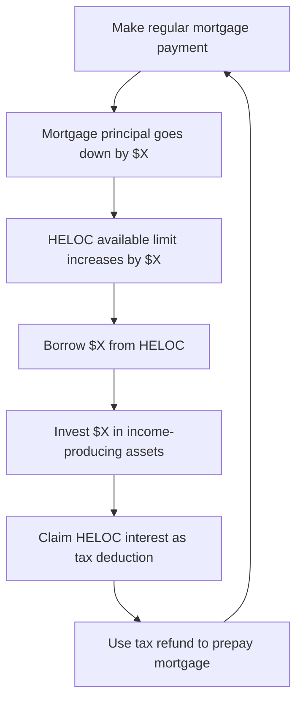

If you live in the United States, you are likely familiar with the mortgage interest tax deduction, which allows you to write off a portion of your interest costs.

But if you live in Canada, you get no such break. Mortgage interest paid on your primary residence is paid in **100% after-tax Canadian dollars**. It is what financial planners refer to as "bad debt" (debt that does not generate income and is not tax-deductible).

However, there is a legendary, completely legal wealth-building loophole known as the **Smith Maneuver**. First popularized by Canadian financial planner Fraser Smith, this strategy allows Canadian homeowners to convert their non-deductible mortgage interest into tax-deductible investment interest, building an enormous investment portfolio _while_ paying off their home years ahead of schedule.

Here is a step-by-step breakdown of how the Smith Maneuver works, the mathematics of the tax savings, and the critical risks you must evaluate.

---

## The Legal Foundation: Good Debt vs. Bad Debt

The entire strategy rests on **Section 20(1)(c) of the Canadian Income Tax Act**. Under this law:

- Interest paid on money borrowed to purchase a primary residence is **not tax-deductible**.
- Interest paid on money borrowed for the purpose of **earning income** (such as purchasing dividend-paying stocks, ETFs, mutual funds, or investment properties in non-registered accounts) **is fully tax-deductible**.

The Smith Maneuver is a systematic process of using a specialized mortgage to swap non-deductible residential debt for deductible investment debt over time, without increasing your overall debt load.

---

## How It Works: The Step-by-Step Blueprint

To execute the Smith Maneuver, you cannot use a standard mortgage. You need a specialized financial product called a **Readvanceable Mortgage**.

A readvanceable mortgage links a traditional amortized home loan with a **Home Equity Line of Credit (HELOC)**. The key feature of this product is that **the credit limit is dynamic**: as you pay down your mortgage principal by $1.00, your available HELOC limit automatically increases by exactly $1.00.

Here is the month-by-month cycle:

1.  **The Mortgage Payment:** You make your standard monthly mortgage payment. A portion of this payment goes toward paying down the principal balance.
2.  **The Readvance:** Because your principal balance dropped, the bank immediately "readvances" that exact amount of credit to your HELOC limit.
3.  **The Invest Step:** You withdraw that exact amount from your HELOC and transfer it into a **non-registered investment account**.
4.  **The Purchase:** You buy income-producing assets (e.g., Canadian dividend-paying stocks or broad-market dividend ETFs).
5.  **The Tax Deduction:** Since the money borrowed from the HELOC was used strictly to buy investments with a reasonable expectation of income, **the interest you pay on that HELOC is now fully tax-deductible**.
6.  **The Accelerator:** At tax time, your deduction yields a substantial refund. Instead of spending this refund, you make a lump-sum prepayment on your main mortgage principal. This immediately readvances more HELOC room, compounding your results.

---

## The Mathematics: A Simulated Example

Let's look at the financial projection. Imagine a Canadian homeowner with the following parameters:

- **Home Value:** $650,000
- **Original Mortgage:** $400,000 at 5.50% interest rate
- **Marginal Tax Rate:** 40.00%
- **Investment Growth Rate (conservative):** 6.50% annually (with dividend payouts)

Over the 25-year life of the mortgage, here is the contrast between a homeowner who does nothing (Standard Route) and a homeowner who executes the Smith Maneuver:

### 📊 Comparative Wealth Table

| Metric                                 | The Standard Route              | The Smith Maneuver Route           |
| :------------------------------------- | :------------------------------ | :--------------------------------- |
| **Mortgage Payoff Time**               | 25 Years                        | **~21 Years (4 Years Saved)**      |
| **Total Non-Deductible Interest Paid** | $333,700                        | **$187,000 (Cut nearly in half!)** |
| **Investment Portfolio Value**         | $0                              | **~$392,000**                      |
| **Total Tax Refunds Claimed**          | $0                              | **~$58,000**                       |
| **Net Wealth Gain**                    | **$0** (just the paid-off home) | **+$392,000 in investments**       |

In this scenario, by the time the mortgage is fully paid off, the homeowner who used the Smith Maneuver has a completely paid-off house _plus_ a **$392,000 investment portfolio** and received **$58,000 in tax refunds** from the CRA.

All of this was accomplished without spending a single dollar more out-of-pocket than their standard monthly mortgage payment.

---

## Critical Risks & CRA Rules

While the Smith Maneuver sounds like free money, it is a form of **leveraged investing** (investing with borrowed money). It is not for everyone. You must understand these rules:

1.  **Market Volatility:** Your investments will fluctuate. If the stock market drops 20%, you still owe the bank the full HELOC balance. If you panic-sell, you lock in losses while maintaining debt.
2.  **Interest Rate Spreads:** HELOC interest rates are variable and typically pegged to Prime (e.g., Prime + 0.5%). If interest rates skyrocket, the cost of servicing your HELOC increases, which can squeeze your cash flow.
3.  **Strict Paper Trails:** The Canada Revenue Agency (CRA) is incredibly strict about tracking. You _must_ have a dedicated HELOC account used **only** for this strategy. If you withdraw even $10 for personal spending (like groceries or a coffee), the entire account's tax-deductibility can be compromised.
4.  **No Registered Accounts:** You **cannot** use HELOC funds to invest in tax-sheltered accounts like TFSAs, RRSPs, or FHSAs. If you do, the interest is **not** tax-deductible because those accounts already enjoy tax-sheltered status.

---

## Is the Smith Maneuver Right for You?

The ideal candidate for the Smith Maneuver is a Canadian homeowner who has:

- A stable, secure income.
- A long-term investment horizon (10+ years).
- A high tolerance for short-term stock market volatility.
- A marginal tax rate high enough (e.g., 30% or more) to make the interest write-off highly valuable.

If you decide to proceed, it is vital to consult a **Certified Smith Maneuver Specialist** or a qualified Canadian accountant to set up the readvanceable mortgage and tracking accounts correctly.

_Want to see how different prepayment values affect your mortgage payoff timeline? Use our [Smart EMI Planner](/) to test extra payments and map out your debt-reduction strategy!_
